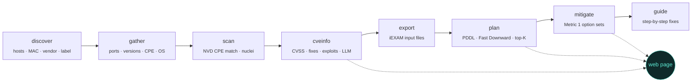

<p align="center">
  
</p>

<p align="center">
  
  
  
  
  
</p>

<p align="center">
  <b>EdgePlanner</b> finds every device on your home network, works out which known vulnerabilities they expose,<br>
  plans how an outside attacker could chain them together, and tells you the smallest set of fixes that blocks every path.<br>
  It runs from a single web page, on a Raspberry Pi 3, without logging in to anything.
</p>

---

## Contents

- [What it does](#what-it-does)
- [How it works](#how-it-works)
- [Safety rules](#safety-rules)
- [Requirements](#requirements)
- [Install](#install)
- [Configure](#configure)
- [Run it](#run-it)
- [What you get](#what-you-get)
- [Local LLM (optional)](#local-llm-optional)
- [Turn a Pi into the EdgePlanner box](#turn-a-pi-into-the-edgeplanner-box)
- [Tests](#tests)
- [Project layout](#project-layout)
- [Credits](#credits)
- [License](#license)

## What it does

A home network has no inventory, no credentials you can hand to a scanner, and plenty of devices nobody has updated in years: cameras, smart speakers, extenders, TVs. EdgePlanner treats it the way an attacker would. It only looks at what the network itself reveals.

1. **Discovers** every live host on the LAN and labels it (router, camera, phone, speaker, computer, ...) from its MAC vendor, hostname, mDNS, SSDP and UPnP announcements.
2. **Fingerprints** each host: open ports, services, product, version, CPE and OS guess.
3. **Matches CVEs** from NVD against those versions, plus live detection-only nuclei checks.
4. **Explains each CVE**: CVSS, CWE, fixed version, patch commits, public exploits, and a plain-language cause and consequence written by an LLM.
5. **Builds an attack graph** (attacker → router → devices) and hands it to the [iEXAM](https://github.com/cryptoknight13/iEXAM-Toolset-main) planner, which writes it out as PDDL.
6. **Plans attacks** with Fast Downward (optimal plan) and ForbidIterative (top-K plans).
7. **Computes mitigations** with iEXAM's Metric 1: sets of changes that block *every* plan, turned into concrete actions such as "upgrade X from version A to B", with evidence links.
8. **Writes fix guides** for each action: how it blocks the attack, step by step, citing only pages it actually fetched.

All of it is driven from one web page: you step through the stages, see the network as a graph, click a device to see how an attacker reaches it and how to block that.

## How it works



Every stage reads the previous stage's JSON from `runs/<run-id>/` and writes its own timestamped, schema-versioned file there. Stages run independently and in order, so you can stop anywhere, inspect the output, and rerun a single stage.

The threat model is an external attacker `n0` reaching the home router, and through it every device on the LAN. Mesh setups (router → extender → devices) are supported. A Wi-Fi extender that bridges its clients is detected from the shared MAC, and its clients are placed behind it.

EdgePlanner is a port of two research systems to a network where you have no access to any device:

| Upstream | Original | Here |
|---|---|---|
| [BATs](https://github.com/cryptoknight13/BATs) (Blue Agent Teams) | agents on lab VMs over SSH + sudo | **agentless**, everything observed from the network |
| [iEXAM](https://github.com/cryptoknight13/iEXAM-Toolset-main) | attack graph, PDDL, planning, Metric 1 | fed by live discovery instead of hand-written input |

## Safety rules

EdgePlanner is built to be safe to point at a real home network.

- **Agentless.** It never logs in to a device, never guesses passwords, never runs an exploit.
- **Scoped.** It scans only the network this machine is directly on (found from the default-route interface), or the subnets you pin in config. Only RFC1918 ranges, /16 or smaller. Nothing on the internet is scanned.
- **Detection only.** nmap and nuclei never run `intrusive`, `dos`, `brute`, `fuzz` or `exploit` checks.
- **Consent first.** The web page asks for permission to scan the current network before the first scan.
- **Secrets stay in `.env`.** API keys and the page login are never written to config, output or git.

> Only scan networks you own or are allowed to test.

## Requirements

| | |
|---|---|
| **Hardware** | Any Linux box on the LAN. Developed on Kali (aarch64); final target is a Raspberry Pi 3 (1 GB RAM). |
| **Python** | 3.13 (every dependency is pure Python or has an aarch64 wheel) |
| **System tools** | `nmap`, `nuclei`, `git`, a C++ toolchain (`build-essential`) to build the planners |
| **API keys** (optional) | `NVD_API_KEY` for faster NVD lookups; an OpenAI-compatible LLM key (default: NVIDIA, `NVIDIA_API_KEY`) for explanations. Or skip the API entirely with a [local LLM](#local-llm-optional). |

## Install

```bash
git clone git@github.com:cryptoknight13/EdgePlanner.git
cd EdgePlanner

# system tools
sudo apt install -y nmap nuclei git build-essential python3-venv

# let nmap do ARP discovery and OS detection without running as root (once)
sudo setcap cap_net_raw,cap_net_admin,cap_net_bind_service+eip "$(which nmap)"

# Python environment (exact versions verified on arm64)
python3 -m venv .venv
.venv/bin/pip install -r requirements.lock

# iEXAM planners: Fast Downward, ForbidIterative, VAL (pinned commits, built natively)
bash iexam/scripts/fetch_planners.sh --build
```

Without the `setcap` step discovery still works, but it falls back to slower TCP-connect probing and says so in its output.

Then create `.env` in the project root:

```ini
# CVE data (optional, but NVD is slow without it)
NVD_API_KEY=...

# LLM explanations (OpenAI-compatible; defaults to NVIDIA's endpoint)
NVIDIA_API_KEY=...
# LLM_BASE_URL=...      # override the endpoint
# LLM_MODEL=...         # override the model

# login for the web page when served on the LAN
EDGEPLANNER_USER=...
EDGEPLANNER_PASSWORD=...
```

## Configure

Everything lives in [`config/settings.yaml`](config/settings.yaml). The defaults work as is. Settings you are most likely to change:

| Key | Default | Meaning |
|---|---|---|
| `interface`, `subnets` | `auto` | Scope. `auto` = the default-route interface and its own network. Pin with e.g. `interface: eth0`, `subnets: [192.168.1.0/24]`. |
| `gather_top_ports` | `1000` | nmap `--top-ports` per host |
| `scan.nuclei_mode` | `fast` | `fast`, `full` or `off` (always detection only) |
| `export.lateral_edges` | `false` | `true` lets a compromised device attack its neighbours directly |
| `plan.k` | `3` | top-K attack plans per goal |
| `llm.provider` | `api` | `api` (hosted) or `local` (llama.cpp on this machine) |

## Run it

### The web page (recommended)

```bash
.venv/bin/python run.py web            # http://127.0.0.1:8080
.venv/bin/python run.py web --host 0.0.0.0 --port 8080   # reachable from other machines on the LAN
```

Open the page, accept the scan permission for your network, and click **New scan**. The stage chips walk you through it:

**Discover Your Devices** → **Gather** → **Scan Your Network** → **Security Profile** (attack graph, optimal and top-K plans per device) → **Mitigate**

Each stage unlocks once the one before it is done, and any finished stage can be rerun on its own. Live output is in the **Logs** drawer. Click a device on the map to see its ports and CVEs, **How an attacker gets here** (the path is drawn in red), and **How to block it**.

### The command line

Each stage is also a `run.py` subcommand. Without `--run`, a stage uses the latest run that has its input.

```bash
.venv/bin/python run.py discover                  # new run in runs/<UTC timestamp>/
.venv/bin/python run.py gather
.venv/bin/python run.py scan
.venv/bin/python run.py cveinfo                   # --no-llm to skip explanations
.venv/bin/python run.py export
.venv/bin/python run.py plan                      # --target NAME, --k K, --optimal, --topk K
.venv/bin/python run.py mitigate                  # --target NAME
.venv/bin/python run.py guide --target NAME
```

`.venv/bin/python run.py --help` lists every option.

## What you get

```
runs/<run-id>/
├── discover.json         every host: IP, MAC, vendor, hostname, label + confidence + evidence
├── gather.json           per host: ports, services, versions, CPE, banners, UPnP/mDNS identity, OS
├── scan.json             per host and port: CVE ids and where each came from (cpe / nuclei)
├── cveinfo.json          per CVE: CVSS, CWE, fixed version, patches, exploits, LLM cause/consequence
├── iexam/                node-data, connectivity-edge, cve-in-node, cve-data (iEXAM's exact format)
├── plans/plans.json      attack graph, optimal and top-K plans per goal, explanations
├── mitigation/           Metric 1 option sets as concrete actions, and fix guides
└── pipeline.log          everything the web page ran
```

All of it is plain JSON, made to be read: you can check every claim the page makes against the stage that produced it. LLM text is always kept apart from the facts the planner uses.

## Local LLM (optional)

Every LLM step can run on the same machine instead of an API, so scan data never leaves the box:

```bash
bash scripts/fetch_llama.sh              # builds llama.cpp's llama-server (CPU only, no sudo)
bash scripts/fetch_model.sh qwen3-0.6b   # downloads a pinned, sha256-checked GGUF model
```

Then set `llm.provider: local` in `config/settings.yaml`. `qwen3-0.6b` needs about 720 MB of memory, which fits on a 1 GB Pi. To compare the small models (and optionally the API) on speed, memory and output quality:

```bash
.venv/bin/python run.py llmbench --models qwen3-0.6b,gemma3-270m --api
```

Results of a full comparison are in [`docs/reports/2026-10-20-small-llm-benchmark.md`](docs/reports/2026-10-20-small-llm-benchmark.md).

## Turn a Pi into the EdgePlanner box

`scripts/install_box.sh` makes the machine a plug-in appliance:

- the web page runs as a service on port 80, behind the login in `.env`, at **http://edgeplanner.local/**
- if the box boots with no cable and no known Wi-Fi, it opens its own **EdgePlanner-Setup** Wi-Fi so you can connect and point it at your home Wi-Fi
- with a cable plugged in, Wi-Fi is dropped so the box has one LAN address

```bash
# add SETUP_WIFI_PASSWORD (8+ characters) to .env as well, then:
sudo bash scripts/install_box.sh
```

The script takes all its values from `config/settings.yaml` (`web`, `box`) and `.env`, and can be rerun safely after a change. Install it on one box only.

## Tests

```bash
.venv/bin/python -m unittest discover -s tests -t .
```

Every parser and every non-trivial transform has a self-check test. The tests use fixtures and a fake LLM server, so they don't touch the network.

## Project layout

```
run.py            orchestrator: one subcommand per stage
discover/         phase 1: hosts, MACs, vendors, labels
gather/           phase 2: ports, services, versions, identity
collector/        link, passive (mDNS/SSDP), active and UPnP probes shared by the stages
scan/             phase 3: NVD CPE matching and nuclei
cveinfo/          phase 4: CVE facts, fixes, exploits, explanations
export/           phase 6: iEXAM input files
attackplan/       phase 7: iEXAM attack graph and planners
mitigate/         phase 8: Metric 1 mitigations and fix guides
netmodel/         network model shared by the page and the export
iexam/            ported iEXAM backend (PDDL generation, planners, Metric 1)
web/              stdlib web server and the single-page UI
llmconf.py        API / local LLM selection; llmbench.py: the model benchmark
config/           settings.yaml and friends
phases/           the roadmap and one design note per phase
scripts/          box installer, llama.cpp and model fetchers
tests/            self-check tests
```

Phase-by-phase design notes and gates are in [`phases/README.md`](phases/README.md).

## Credits

- **[BATs](https://github.com/cryptoknight13/BATs)** and **[iEXAM](https://github.com/cryptoknight13/iEXAM-Toolset-main)**: the systems this project ports. Code reused from them notes its origin in the module docstring.
- **[Fast Downward](https://github.com/aibasel/downward)**, **[ForbidIterative](https://github.com/IBM/forbiditerative)**, **[VAL](https://github.com/KCL-Planning/VAL)**: planning and plan validation.
- **[nmap](https://nmap.org)**, **[nuclei](https://github.com/projectdiscovery/nuclei)**, **[NVD](https://nvd.nist.gov)**: discovery, detection and vulnerability data.
- **[llama.cpp](https://github.com/ggml-org/llama.cpp)**: local LLM inference.
- **[Cytoscape.js](https://js.cytoscape.org)**: the network graph on the page.

## License

[MIT](LICENSE), except the pyperplan grounder under `iexam/Backend/pages/_metric1/`, which stays under GPLv3. See [`LICENSE`](LICENSE) for details.
